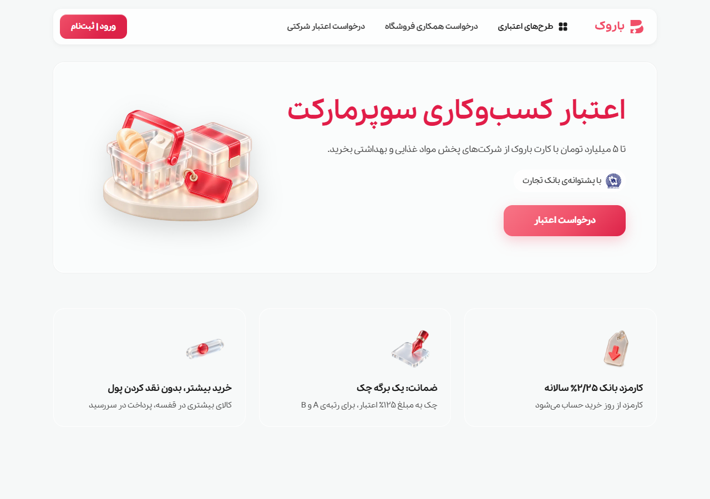
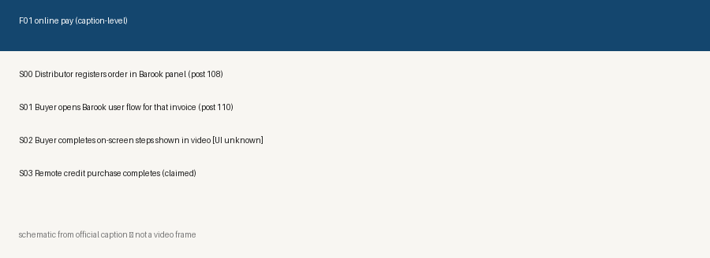
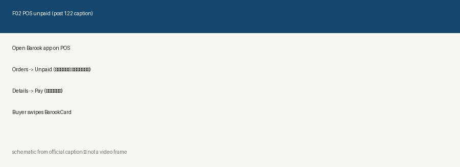
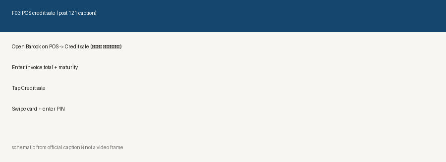
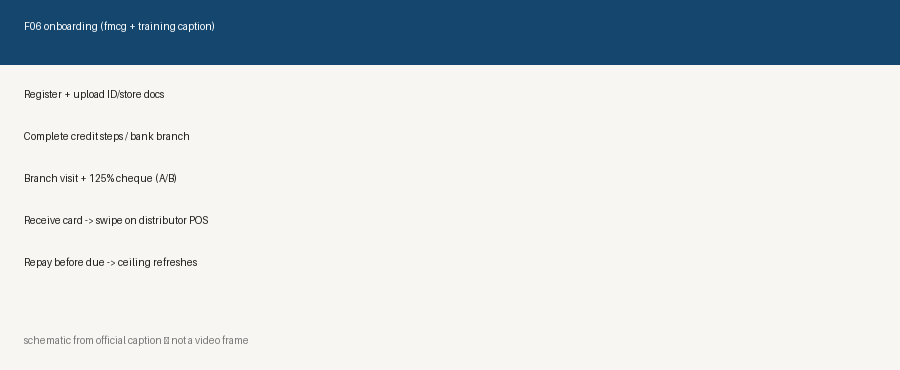
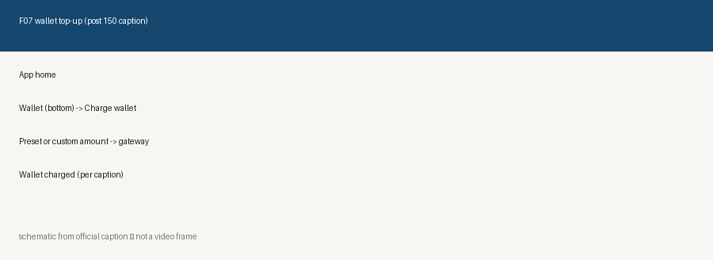

# استخراج فلوهای آموزشی باروک برای سوپرمارکت و شرکت

**تاریخ مشاهده:** 1405/09/04  
**منبع اصلی کانال:** [@barook_ir](https://t.me/barook_ir) · ایندکس: [پست ۵۵](https://t.me/barook_ir/55) · جست‌وجوی [#آموزش](https://telegram.me/s/barook_ir?q=%23آموزش)

## خلاصه اجرایی

مسیر عملیاتی غالب سوپرمارکت: ثبت‌نام/شعبه/کارت → سفارش با پخش طرف‌قرارداد → **یا** فروش اعتباری روی پوز، **یا** پیش‌فاکتور پرداخت‌نشده روی پوز هنگام تحویل، **یا** پرداخت آنلاین پس از ثبت فاکتور توسط پخش. بایت ویدئوهای تلگرام روی ماشین پژوهشی مسدود بود؛ فلوها از کپشن رسمی زمان‌دار/گام‌دار + صفحهٔ `barook.ir/fmcg` ساخته شدند. فریم جعلی از ویدئو ثبت نشده است.

| شاخص | مقدار |
| --- | --- |
| فلو کامل (گام‌ها از کپشن/سایت قابل اجرا، بدون نیاز به تماشای فیلم) | ۴ (F02, F03, F06, F07) |
| فلو ناقص (آغاز/نتیجه یا برچسب دکمهٔ میانی کم است) | ۵ (F01, F04, F05, F08, F11) |
| فاقد شاهد اجرایی کافی در کپشن | چند عنوان ایندکس (توکن حقوقی، باطل کارت، پوشاک، دیجیتال) |
| L4 معامله واقعی | ۰ |

## فهرست کلیک‌خور

- [مانع دسترسی رسانه](#مانع-دسترسی-رسانه)
- [F01 پرداخت آنلاین خریدار (۱۱۰)](#f01-پرداخت-آنلاین-خریدار-پست-۱۱۰)
- [F02 پوز پرداخت‌نشده‌ها (۱۲۲)](#f02-پوز-پرداخت-نشدهها-پست-۱۲۲)
- [F03 پوز فروش اعتباری (۱۲۱)](#f03-پوز-فروش-اعتباری-پست-۱۲۱)
- [F04 ثبت سفارش توسط پخش (۱۰۸)](#f04-ثبت-سفارش-توسط-پخش-پست-۱۰۸)
- [F05 آپلود فاکتور (۱۴۱)](#f05-آپلود-فاکتور-تأمینکننده-پست-۱۴۱)
- [F06 ثبت‌نام و اعتبار فروشگاه](#f06-ثبتنام-و-فعالسازی-اعتبار-فروشگاه)
- [F07 شارژ کیف پول (۱۵۰)](#f07-شارژ-کیف-پول-پست-۱۵۰)
- [F08–F11 ناقص](#f08f11-سایر-فلوهای-ناقص)
- [انتقال مسئولیت بین نقش‌ها](#انتقال-مسئولیت-بین-نقشها)
- [ماتریس پوشش](#ماتریس-پوشش-نقش--فرایند)
- [سه خلأ اصلی](#سه-خلأ-اصلی)

## مانع دسترسی رسانه

بایت ویدئو از این ماشین پژوهشی قابل دریافت نبود: اتصال مستقیم به t.me و cdn*.telesco.pe با timeout قطع می‌شود (Playwright/Chrome و SOCKS5 هم ناموفق). کپشن رسمی و مدت از ویجت تلگرام/WebFetch خوانده شد. فریم داخل‌ویدئو تولید یا جعل نشده است.

آخرین شاهد دقیق برای پست ۱۱۰: ویجت تلگرام با مدت **۰:۵۲** و کپشن کامل «پرداخت آنلاین توسط خریدار…» از `https://t.me/barook_ir/110?embed=1&mode=tme` در WebFetch. جایگزین رسمی آپارات کانال `aparat.com/barook` در این مشاهده محتوای آموزشی معادل نشان نداد. کانال بله (`ble.ir/s/barookapp`) ویدئوهای بازاریابی داشت، نه معادل ۱۱۰/۱۲۲/۱۴۱.

*شاهد صفحهٔ عمومی — نه فریم ویدئو.*

## F01 — پرداخت آنلاین خریدار (پست ۱۱۰)

| فیلد | مقدار |
| --- | --- |
| شناسه | F01 |
| عنوان | پرداخت اعتباری آنلاین پس از ثبت سفارش پخش |
| نقش | سوپرمارکت (خریدار) |
| آغاز | سفارش/فاکتور توسط شرکت پخش در پنل باروک ثبت شده (پیش‌نیاز: F04 / SRC-TG-108) |
| پیش‌نیاز | باروک‌کارت فعال؛ سفارش ثبت‌شده توسط پخش |
| پایان قابل مشاهده در شاهد متنی | تکمیل پرداخت آنلاین بدون حضور فیزیکی — جزئیات صفحهٔ موفقیت در کپشن نیست |
| وضعیت | **ناقص** — ویدئو مسدود؛ کپشن مراحل دکمه را نام نمی‌برد |

| گام | نقش و صفحه | اقدام و متن دقیق گزینه | دادهٔ لازم | نتیجهٔ دیده‌شده و اقدام بعدی | شاهد |
| --- | --- | --- | --- | --- | --- |
| F01-S00 | شرکت پخش / پنل | ثبت سفارش فروشگاه در پنل (آموزش جدا) | شناسه فروشگاه، اقلام | سفارش آمادهٔ تأیید/پرداخت خریدار | SRC-TG-108 · 0:35 |
| F01-S01 | خریدار / اپ یا پنل کاربری باروک | ورود به مسیر پرداخت آنلاین همان سفارش (جزئیات دکمه فقط در ویدئو) | حساب کاربری باروک | شروع جریان پرداخت اعتباری | SRC-TG-110 · 0:52 · کپشن |
| F01-S02 | خریدار | طی مراحل نشان‌داده‌شده در ویدئو | — | پرداخت اعتباری آنلاین | SRC-TG-110 · حد شاهد: UI نامشخص بدون فیلم |
| F01-S03 | سیستم/پخش | نتیجه به شرکت برمی‌گردد (ادعا در کپشن ۱۰۸) | — | تکمیل خرید/فروش اعتباری از راه دور | SRC-TG-108+110 · اثر روی مانده در شاهد نیست |

**حد شاهد:** آغاز کار شرکت در فیلم ۱۱۰ نیست → به F04 ارجاع. پیام موفقیت، اثر مانده، مجوز ارسال در کپشن ۱۱۰ دیده نشد.

مسیر موازی اعلام‌شده برای بنک‌مارکت: ۱) پرداخت آنلاین باروک پس از ثبت فاکتور در باروک ۲) کارت هنگام تحویل.

## F02 — پوز: پرداخت‌نشده‌ها / پیش‌فاکتور (پست ۱۲۲)

| فیلد | مقدار |
| --- | --- |
| شناسه | F02 |
| نقش | موزع/پخش روی پوز + دارنده کارت |
| آغاز | اپ باروک روی POS باز است؛ پیش‌فاکتور صادر شده |
| پایان | کشیدن کارت توسط خریدار |
| وضعیت | **کامل در سطح کپشن اجرایی** (بدون فریم) |

| گام | نقش و صفحه | اقدام و متن دقیق گزینه | دادهٔ لازم | نتیجه و بعدی | شاهد |
| --- | --- | --- | --- | --- | --- |
| F02-S01 | موزع / اپ باروک روی POS | ورود به اپلیکیشن باروک | — | صفحهٔ اصلی اپ پوز | SRC-TG-122 |
| F02-S02 | موزع / سفارشات | باز کردن بخش «سفارشات» | — | فهرست سفارشات | SRC-TG-122 |
| F02-S03 | موزع | کلیک روی «پرداخت نشده‌ها» | — | لیست پیش‌فاکتورهای باز | SRC-TG-122 · متن دقیق گزینه |
| F02-S04 | موزع / جزئیات | کلیک روی «پرداخت» | انتخاب همان پیش‌فاکتور | درخواست کشیدن کارت | SRC-TG-122 |
| F02-S05 | خریدار | کشیدن باروک‌کارت روی دستگاه | کارت فیزیکی | تکمیل پرداخت از دید کپشن | SRC-TG-122 · رمز در این کپشن ذکر نشده (در F03 هست) |

**نکتهٔ تحویل:** مأموریت «رویهٔ تحویل» را به ۱۲۲ نگاشته؛ شاهدِ متنی همان تسویهٔ پیش‌فاکتور روی پوز هنگام حضور کارت است، نه چک‌لیست انبار/رسید کالا.

## F03 — پوز: فروش اعتباری (پست ۱۲۱)

| فیلد | مقدار |
| --- | --- |
| شناسه | F03 |
| نقش | اپراتور پوز + خریدار |
| آغاز | اپ باروک روی POS |
| پایان | کشیدن کارت + ورود رمز |
| وضعیت | **کامل در سطح کپشن اجرایی** |

| گام | نقش و صفحه | اقدام و متن دقیق گزینه | دادهٔ لازم | نتیجه و بعدی | شاهد |
| --- | --- | --- | --- | --- | --- |
| F03-S01 | اپراتور / POS | باز کردن اپلیکیشن باروک | — | منوی باروک | SRC-TG-121 |
| F03-S02 | اپراتور | کلیک «فروش اعتباری» | — | فرم مبلغ/سررسید | SRC-TG-121 · متن گزینه |
| F03-S03 | اپراتور | وارد کردن مبلغ جمع فاکتور و مدت سررسید (از نماینده پخش بپرس) | مبلغ؛ سررسید | آمادهٔ تأیید | SRC-TG-121 |
| F03-S04 | اپراتور | کلیک دکمه «فروش اعتباری» | — | درخواست کارت | SRC-TG-121 |
| F03-S05 | خریدار | کشیدن باروک‌کارت و ورود رمز | کارت + رمز | تراکنش اعتباری از دید کپشن | SRC-TG-121 |

نسخهٔ قدیمی‌تر با کپشن نازک: SRC-TG-017 (پست ۱۷). اختلاف نقش/تاریخ: ۱۷ قدیمی‌تر از ۱۲۱/۱۲۲.

## F04 — ثبت سفارش توسط پخش برای پرداخت/تأیید از راه دور (پست ۱۰۸)

| وضعیت | **ناقص** — کپشن هدف را می‌گوید؛ دکمه‌های پنل را نام نمی‌برد |

| گام | نقش و صفحه | اقدام | داده | نتیجه | شاهد |
| --- | --- | --- | --- | --- | --- |
| F04-S01 | پخش / پنل باروک | ثبت سفارش فروشگاه‌دار به روش نمایش‌داده‌شده در ویدئو | شناسه فروشگاه؛ اقلام | سفارش ثبت می‌شود | SRC-TG-108 · 0:35 |
| F04-S02 | خریدار | تأیید خرید اعتباری / پرداخت (F01) | — | تکمیل دور از محل | SRC-TG-108+110 |

## F05 — آپلود فاکتور تأمین‌کننده (پست ۱۴۱)

| وضعیت | **ناقص** — فقط وعدهٔ قدم‌به‌قدم در کپشن؛ نام منو/فیلد نیست |

| گام | نقش | اقدام | شاهد |
| --- | --- | --- | --- |
| F05-S01 | تأمین‌کننده / پنل | ورود به پنل تأمین‌کننده باروک | SRC-TG-141 · 1:41 |
| F05-S02 | تأمین‌کننده | آپلود فاکتورها (جزئیات UI فقط در ویدئو) | SRC-TG-141 · حد شاهد |

## F06 — ثبت‌نام و فعال‌سازی اعتبار فروشگاه

| شناسه | F06 |
| نقش | سوپرمارکت |
| منابع | کپشن آموزشی ثبت‌نام در فهرست #آموزش + `barook.ir/fmcg` + راهنمای شریک عظیمی |
| وضعیت | **کامل در سطح سند عمومی** (بدون نیاز به فیلم برای مسیر اصلی) |

| گام | نقش و صفحه | اقدام و متن گزینه | داده | نتیجه و بعدی | شاهد |
| --- | --- | --- | --- | --- | --- |
| F06-S01 | خریدار / barook.ir | ثبت‌نام / درخواست اعتبار | — | شروع پرونده | SRC-OFF-FMCG · کپشن #آموزش |
| F06-S02 | خریدار | بارگذاری هویت، فروشگاه، کارت ملی، سند کسب | مدارک | پرونده ناقص→کامل | SRC-OFF-FMCG |
| F06-S03 | خریدار | کلیک «مراحل دریافت اعتبار را تکمیل کنید» | — | انتظار چند ساعت | کپشن ثبت‌نام آموزشی |
| F06-S04 | خریدار | مشاهده نتیجه در همان بخش؛ کلیک «ادامه مراحل بانکی» | — | انتخاب شعبه | کپشن ثبت‌نام |
| F06-S05 | خریدار | انتخاب شعبه تجارت؛ بستن نوبت با ✖️؛ دیدن تاریخ مراجعه در صفحه اصلی | شعبه | نوبت بانک | کپشن ثبت‌نام |
| F06-S06 | خریدار+بانک / شعبه | مراجعه با مدارک؛ چک ضمانت ۱۲۵٪ برای A/B | چک؛ مدارک | سقف اعتبار؛ ارسال کارت | SRC-OFF-FMCG |
| F06-S07 | خریدار | اعلام داشتن کارت به ویزیتور؛ مذاکره سررسید | — | آمادهٔ خرید | SRC-OFF-FMCG |
| F06-S08 | خریدار | کشیدن کارت روی کارتخوان باروک مأمور تحویل | کارت | مصرف اعتبار | SRC-OFF-FMCG |
| F06-S09 | خریدار / حساب جاری تجارت | تأمین وجه قبل از سررسید | وجه | کسر اصل+۲٫۲۵٪؛ برگشت سقف | SRC-OFF-FMCG |

## F07 — شارژ کیف پول (پست ۱۵۰)

| وضعیت | **کامل در سطح کپشن اجرایی** |

| گام | نقش و صفحه | اقدام | داده | نتیجه | شاهد |
| --- | --- | --- | --- | --- | --- |
| F07-S01 | خریدار / اپ | صفحه اصلی اپ باروک | — | — | SRC-TG-150 |
| F07-S02 | خریدار | دکمه «کیف پول» پایین اپ → «شارژ کیف پول» | — | صفحه مبلغ | SRC-TG-150 · متن گزینه |
| F07-S03 | خریدار | مبلغ پیش‌فرض یا مبلغ دلخواه → درگاه پرداخت | مبلغ | پرداخت | SRC-TG-150 |
| F07-S04 | سیستم | اعلام موفقیت شارژ در کپشن | — | آمادهٔ خرید با کیف | SRC-TG-150 · اثر حساب بانکی خارج از شاهد |

## F08–F11 سایر فلوهای ناقص

| فلو | منبع | آنچه داریم | آنچه کم است |
| --- | --- | --- | --- |
| F08 فعالسازی کارت | SRC-TG-013 · 1:08 | هدف آموزش | گام UI |
| F09 نصب روی P10 | SRC-TG-058 · 3:25 | مدل دستگاه توسن‌تکنو P10؛ هدف نصب | گام نصب |
| F10 به‌روزرسانی اپ پوز | SRC-TG-060 · 1:07 | هدف به‌روزرسانی | منو/دکمه |
| F11 کسب‌نو حقوقی | SRC-TG-109 · 0:58 | مدیریت حق امضا مطابق روزنامه رسمی؛ مدیریت فاکتور | مسیر با/بدون توکن در این کپشن جدا نشده؛ ایندکس ۵۵ به آموزش‌های جدا اشاره دارد |

عناوین ایندکس ۵۵ که در این دور شناسهٔ پستشان به کپشن گام‌دار نرسید (شاهد پیدا نشد / فقط عنوان): ثبت‌نام کسب‌نو دیجیتال، پوشاک، حقوقی بدون توکن، حقوقی با توکن، باطل کردن کارت، لیست پخش استانی.

## انتقال مسئولیت بین نقش‌ها

| نقطه | از | به | شاهد |
| --- | --- | --- | --- |
| ثبت سفارش/فاکتور در پنل | پخش | خریدار می‌تواند آنلاین بپردازد | SRC-TG-108 → SRC-TG-110 |
| انتخاب پرداخت‌نشده + پرداخت | موزع روی پوز | خریدار کارت می‌کشد | SRC-TG-122 |
| ورود مبلغ/سررسید فروش اعتباری | اپراتور پوز | خریدار کارت+رمز | SRC-TG-121 |
| نتیجه پرداخت از راه دور | خریدار | تکمیل معامله برای پخش (ادعا) | SRC-TG-108 کپشن |

## ماتریس پوشش نقش × فرایند

| فرایند | سوپرمارکت | حقوقی متقاضی | پخش/تأمین‌کننده |
| --- | --- | --- | --- |
| ثبت‌نام و احراز | F06 کامل‌متن | F11 ناقص | — |
| مدارک فروشگاه | F06 | عنوان ایندکس؛ جزئیات کم | — |
| درخواست/فعالسازی اعتبار | F06 | F11 + عناوین توکن | — |
| مشاهده مانده/سقف | صفحه FMCG ادعا؛ UI داخل حساب نه | — | — |
| دریافت/فعالسازی کارت | F08 ناقص + F06 ارسال کارت | — | — |
| یافتن سفارش/فاکتور | F01 ناقص UI | — | F04/F05 |
| پرداخت اعتباری آنلاین | F01 ناقص UI | — | پیش‌نیاز F04 |
| پرداخت با کارت‌خوان | F02/F03 | — | F02/F03 |
| پیگیری موفقیت/خطا | شاهد پیدا نشد | شاهد پیدا نشد | شاهد پیدا نشد |
| بازپرداخت | F06-S09 سند رسمی | — | تسویه از بانک (ادعا) |
| تحویل | مسیر کارت هنگام تحویل (FMCG+بنک) | — | F02 مرتبط پوز |
| مغایرت/مرجوعی | شاهد پیدا نشد | — | شاهد پیدا نشد |
| پذیرندگی/نصب پوز | — | — | F09/F10 ناقص UI |
| آپلود فاکتور | — | — | F05 ناقص UI |
| شارژ کیف | F07 کامل‌کپشن | — | — |

## سه خلأ اصلی

1. **بایت ویدئو تلگرام ۱۱۰/۱۲۲/۱۴۱ و بقیه** — نوع شاهد لازم: فایل mp4 رسمی یا میزبانی آپارات معادل + رونوشت زمان‌دار از خود رسانه (بستن G-BK-06).
2. **صفحهٔ موفقیت پرداخت آنلاین و اثر مانده** — نوع شاهد: اسکرین ماسک‌شدهٔ اپ خریدار پس از F01 یا سند تراکنش بی‌نام.
3. **آموزش‌های حقوقی با/بدون توکن و باطل کارت** — نوع شاهد: پست‌های لینک‌شده از ایندکس ۵۵ با کپشن/ویدئو گام‌دار.

## پیوست: اتصال به پژوهش قبلی

- G-BK-06 همچنان باز است از حیث فریم/رونوشت زمان‌دار ویدئو؛ این بسته کپشن‌ها و فلوهای متنی را جلو می‌برد.
- OrderSteps قبلی (OS-BK-*) با F02/F03/F06 هم‌راستا است؛ F01 مسیر موازی آنلاین را اضافه می‌کند و نباید با پنل فرضی سناریوی ۰٫۱۰ یکی گرفته شود.
